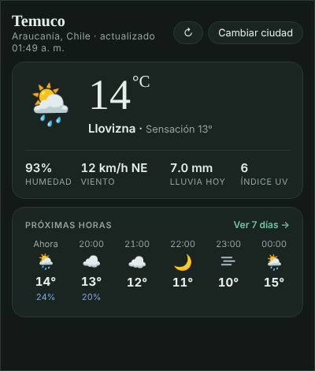
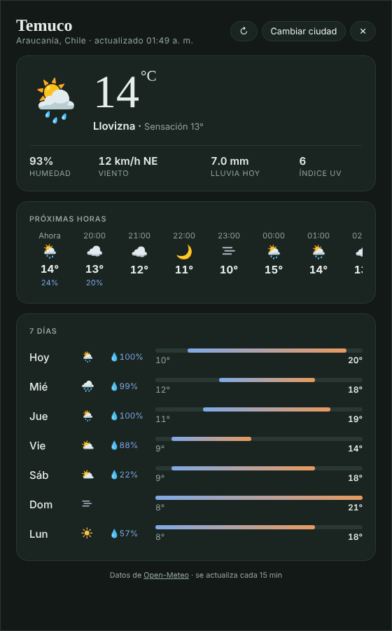

# Tiempo Temuco

Un pequeño programa para Windows que muestra **la temperatura de tu ciudad junto al reloj**, en la barra de tareas. Con un clic se despliega un panel con el tiempo actual y las próximas horas, y desde ahí puedes abrir el pronóstico de 7 días.

Viene configurado para **Temuco, Chile**, pero puedes elegir cualquier ciudad del mundo.

<p>
  
  &nbsp;
  
</p>

## Qué hace

- **Temperatura y cielo en la barra de tareas.** Junto al reloj aparece un dibujo del estado del cielo (sol, luna, nubes, lluvia, nieve, tormenta o neblina) y la temperatura con su símbolo (por ejemplo **14°**). Se actualiza cada 10 minutos.
- **Panel desplegable.** Clic en el número: aparece abajo a la derecha con temperatura, sensación térmica, humedad, viento, lluvia del día, índice UV y las próximas 24 horas. Se cierra con otro clic, haciendo clic fuera o con `Esc`.
- **Pronóstico completo.** El botón **"Ver 7 días →"** abre un panel más amplio con los próximos 7 días.
- **Cualquier ciudad.** Con **"Cambiar ciudad"** buscas otra; el programa la recuerda.
- **Arranca con Windows.** Al encender el PC solo aparece el número, sin abrir ventanas. Se puede desactivar.
- **Menú con clic derecho:** ver el panel, pronóstico completo, actualizar ahora, iniciar con Windows y salir.

## Cómo instalarlo

1. Ve a [**Releases**](../../releases) y descarga `Tiempo.Temuco.exe`.
2. Guárdalo en una carpeta fija (por ejemplo, el Escritorio o Documentos) y ábrelo con doble clic.
3. La primera vez, Windows puede mostrar el aviso azul **"Windows protegió su PC"**. Aparece porque el programa no tiene una firma digital de pago, no porque tenga algo malo. Haz clic en **Más información → Ejecutar de todas formas**. Si prefieres, puedes revisar el código de este repositorio o compilarlo tú mismo (ver abajo).
4. Si el número queda escondido dentro de la flechita **^** de la barra de tareas, arrástralo junto al reloj para dejarlo siempre visible.

No necesita instalación ni permisos de administrador.

### Requisitos

- Windows 10 u 11 (64 bits).
- **Microsoft Edge WebView2**, que ya viene en Windows 11 y en la mayoría de los Windows 10 actualizados. Si falta, el pronóstico se abre en una ventana de Edge.
- Conexión a internet.

### Desinstalar

Clic derecho en el número → desmarca **"Iniciar con Windows"** → **Salir**. Después borra el `.exe` y la carpeta `%LOCALAPPDATA%\TiempoTemuco`.

## Cómo funciona

- Los datos del tiempo vienen de [Open-Meteo](https://open-meteo.com), un servicio gratuito que no requiere cuenta.
- El programa (en Go) dibuja el número en la bandeja de Windows y levanta un pequeño servidor local en `127.0.0.1:47813` que entrega la página de los paneles (`index.html`).
- Los paneles se muestran con WebView2, sin bordes, encima de la barra de tareas.
- La ciudad elegida y los ajustes se guardan en `%LOCALAPPDATA%\TiempoTemuco`. El programa no envía datos a ningún lugar aparte de las consultas a Open-Meteo.

### Ajustes opcionales

Puedes crear `%LOCALAPPDATA%\TiempoTemuco\paneles.json` para cambiar el lado y el ancho del pronóstico completo:

```json
{ "lateral": "derecha", "anchoLateral": 560, "anchoReloj": 400 }
```

## Compilarlo tú mismo

Necesitas [Go](https://go.dev/dl/) 1.24 o más reciente. Desde la carpeta del repositorio:

```bash
GOOS=windows GOARCH=amd64 go build -trimpath -ldflags "-s -w -H=windowsgui" -o "Tiempo Temuco.exe" .
```

En Windows (PowerShell):

```powershell
$env:GOOS="windows"; $env:GOARCH="amd64"
go build -trimpath -ldflags "-s -w -H=windowsgui" -o "Tiempo Temuco.exe" .
```

El archivo `rsrc_windows_amd64.syso` contiene el ícono del programa y Go lo incluye automáticamente.

## Créditos

- Datos meteorológicos: [Open-Meteo](https://open-meteo.com) (CC BY 4.0).
- Paneles con [go-webview2](https://github.com/jchv/go-webview2).
- Tipografías: Fraunces y Figtree, de Google Fonts.

## Licencia

[MIT](LICENSE) © 2026 Manfred Quezada
